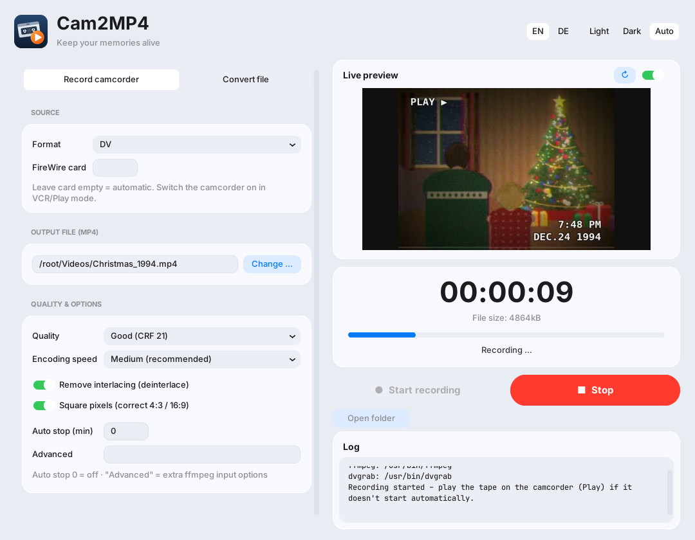
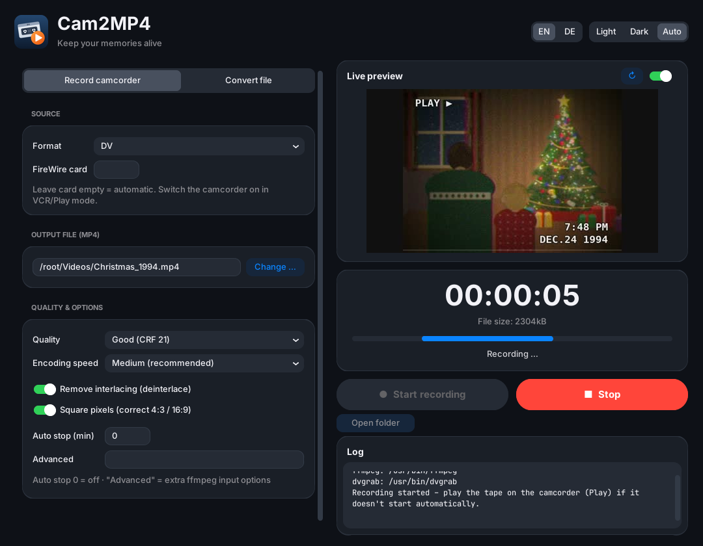

Cam2MP4 digitizes camcorder tapes over FireWire (DV/HDV) and converts video files straight to MP4, with a live preview.

## Screenshots

  
  

<em>Recording an old Christmas tape: live preview, elapsed time and file size while the MP4 is written.</em>

## First start

- **Windows**: SmartScreen shows "Windows protected your PC" because the file is unsigned → *More info* → *Run anyway*.
- **macOS**: right-click `FireWire2MP4.app` → *Open* → *Open*. If it says the app is damaged, run
  `xattr -dr com.apple.quarantine FireWire2MP4.app`. Allow camera/microphone access when asked.
- **Linux**: `tar -xzf FireWire2MP4-linux-*.tar.gz && ./FireWire2MP4`. For FireWire capture install `dvgrab`
  (`sudo apt install dvgrab`); converting files works without it.

The first start of the single-file builds takes a few seconds while the program unpacks itself.

